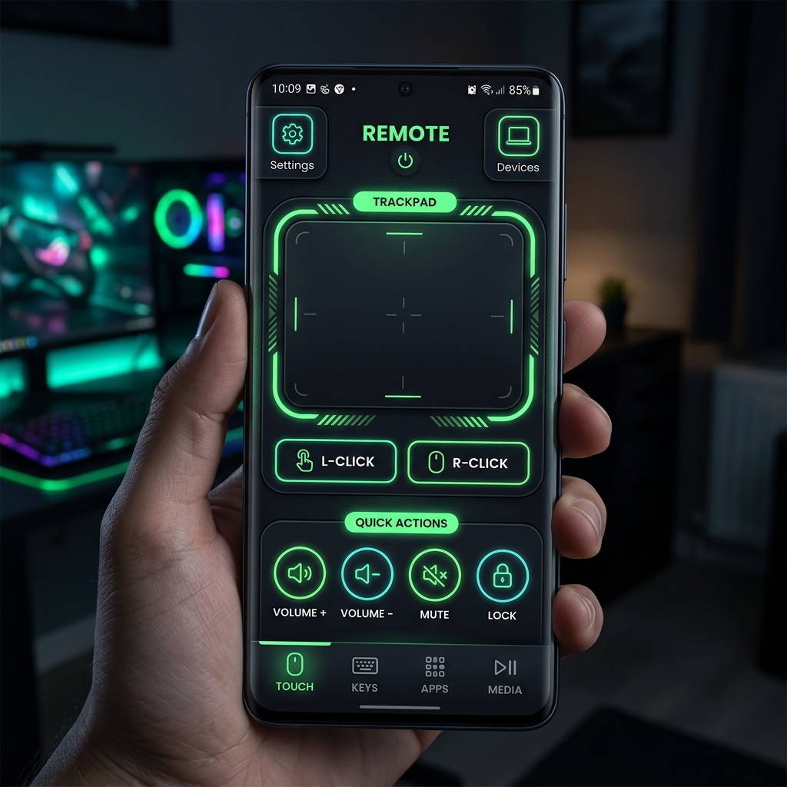
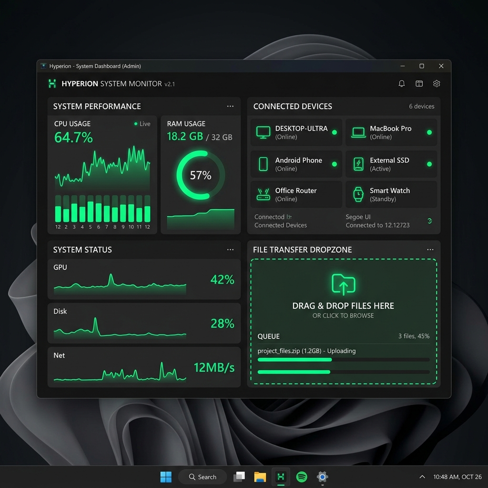

<h1 align="center">
  <br>
  MoodLink
</h1>

<p align="center">
  <b>A high-performance, bidirectional remote control ecosystem connecting Windows PCs and Android devices over your local network.</b>
</p>

<p align="center">
  
  
  
  
</p>

---

## 🎯 Why I Built It

MoodLink was built to provide a fast, low-latency remote control solution between Android devices and Windows PCs over a local network, focusing on raw performance, modularity, and bypassing aggressive mobile background restrictions. It aims to eliminate the friction of existing remote apps by providing true two-way communication without relying on third-party cloud servers.

## ✨ Features

- **Remote Trackpad:** Transform your Android touchscreen into a highly responsive laptop-style trackpad with two-finger scrolling.
- **Screen Mirroring:** Low-latency, Peer-to-Peer WebRTC desktop streaming directly to your phone.
- **Two-Way Audio:** Force the PC's microphone on, or manage advanced audio mixing dynamically.
- **System Monitoring:** Live telemetry for CPU, RAM, and Battery usage.
- **Presentation Mode:** Hook into your phone's gyroscope to use it as a 3D laser pointer on your PC screen.
- **Bi-directional Clipboard:** Seamlessly sync text between your PC and phone.
- **File Transfer:** Wirelessly blast files from your phone directly to the PC's Downloads folder.

## 🏗️ Architecture

MoodLink utilizes a modular monorepo structure. A local Node/Express server acts as the central hub, utilizing WebSockets for real-time telemetry and commands, and WebRTC for low-latency media streams.

```mermaid
graph TD
    subgraph Mobile Device (Remote)
        A[Android App<br/>React Native]
        E[Foreground Service<br/>Notifee] -.->|Keeps alive| A
    end
    
    subgraph Windows PC (Host)
        B((Local Node Server<br/>Express + Socket.io))
        C[Desktop App<br/>Electron]
        D[Native OS<br/>PowerShell]
        
        C -.->|Hosts| B
        C -->|Executes async| D
    end
    
    A <==>|Socket.io<br/>Commands & Telemetry| B
    A <==>|WebRTC P2P<br/>Screen & Audio| C
    A -->|HTTP POST<br/>File Transfers| B
```

## 🛠️ Technologies Used

- **Android:** React Native, Expo, Java/Kotlin (Native Modules), Notifee (Foreground Services)
- **Windows / Server:** Electron, Node.js, Express, Socket.io
- **Media & Networking:** WebRTC, TCP/UDP Sockets, HTTP Networking
- **System Integration:** Windows PowerShell, RobotJS (Input processing)

## 📸 Screenshots

*(Mockup previews of the MoodLink UI. Replace with real application screenshots soon!)*

| Android Remote Interface | Windows Dashboard Server |
| :---: | :---: |
|  |  |

## 🚀 Getting Started

### Prerequisites
- Node.js (v18+)
- Expo CLI
- A Windows PC (Host) and Android device (Remote)

### 1. Running the Desktop App

```bash
# Clone the repository
git clone https://github.com/Moodlood/moodlink.git
cd moodlink

# Install dependencies and start server
npm install
npm run dev
```
*The desktop app will launch and display a pairing QR code.*

### 2. Running the Mobile App

```bash
# Open a new terminal tab
cd mobile

# Install dependencies and start client
npm install
npm start
```
*Scan the Expo QR code with your Android device to launch the app.*

### 3. Pairing
Make sure both devices are on the **same Wi-Fi network**. Open the mobile app, tap **Connect**, and scan the QR code displayed on the PC.

## 🛣️ Roadmap

- [ ] iOS Support (via React Native)
- [ ] Bluetooth LE Fallback (for networks that block WebSockets)
- [ ] Custom Macro Keyboard layouts
- [ ] Wake-on-LAN functionality

## 📄 License
This project is licensed under the MIT License - see the [LICENSE](LICENSE) file for details.
