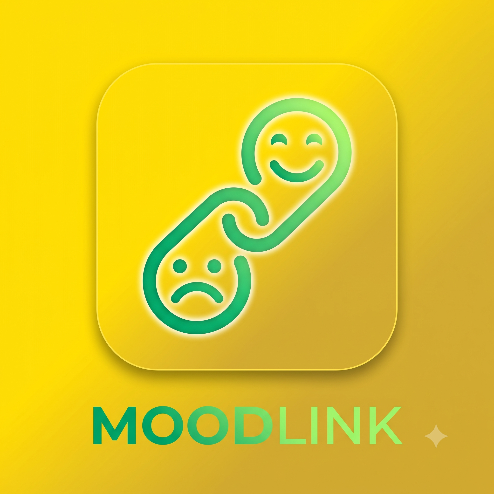
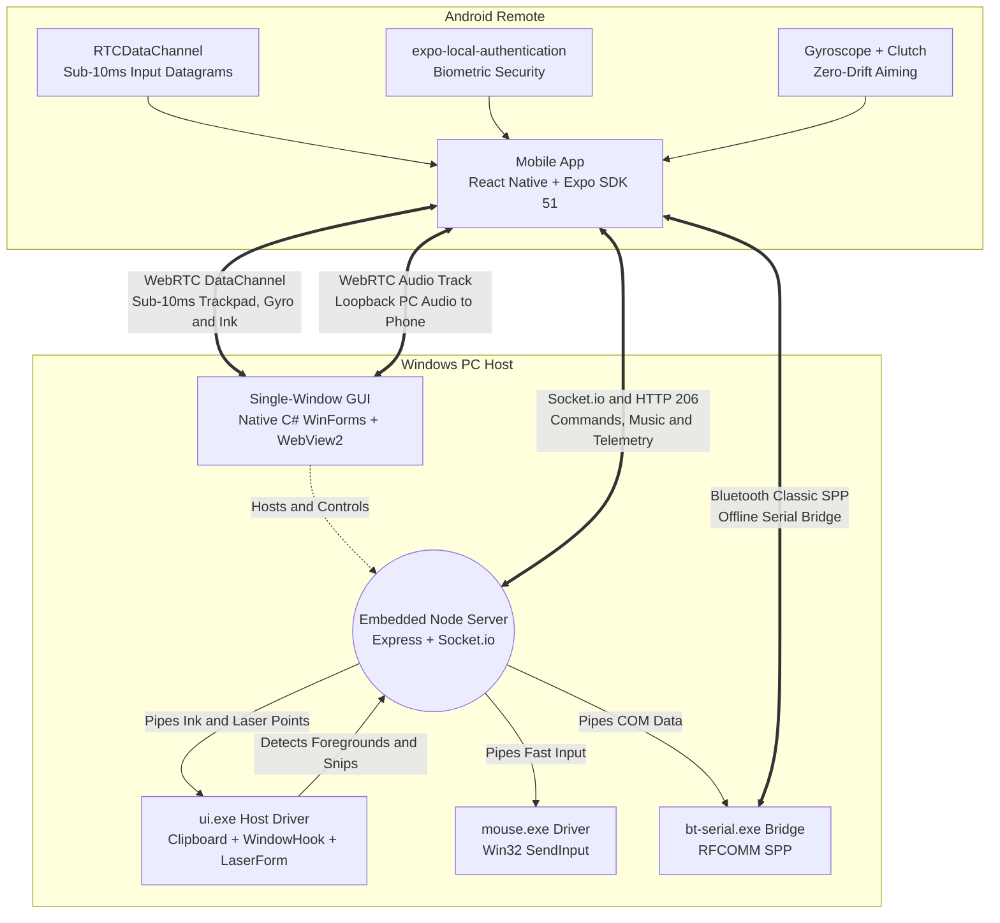

<h1 align="center">
  <br>
  MoodLink
</h1>

<p align="center">
  <b>A high-performance, strictly symmetrical, bidirectional remote control ecosystem connecting Windows PCs and Android devices over Wi-Fi LAN and Bluetooth Classic.</b>
</p>

<p align="center">
  
  
  
  
  
  
</p>

---

## Real Screenshot Showcase

<table>
  <tr>
    <td width="58%" align="center" valign="top">
      <b>Windows Desktop Host (Single-Window Dashboard)</b><br>
      <sub>Real-time device status, battery gauge, connected mobile device telemetry, and quick launch tiles.</sub><br><br>
      
    </td>
    <td width="42%" align="center" valign="top">
      <b>Android Remote (PC Control Center)</b><br>
      <sub>Biometric lock, context-aware Stream Deck, two-way audio modes, and system power actions.</sub><br><br>
      
    </td>
  </tr>
</table>

---

## Overview

**MoodLink** is engineered from the ground up on the principle of **strict bi-directional feature symmetry**: nothing is one-way. Control your PC from your phone, and seamlessly cast audio, camera feeds, clipboard items, screenshots, and files back and forth with zero cloud dependency and sub-10ms input latency.

The ecosystem is wrapped in a signature, high-contrast **Black, Yellow, Green, and White** design language across both Android and Windows interfaces.

### Core Architecture Highlights

- **Strict Bi-Directional Symmetry:** Every feature has an equivalent opposite-direction capability. Phone audio casts to PC speakers, while PC system audio streams to phone headphones. Phone photos inject into Windows clipboard, while PC Snipping Tool screenshots instantly push to Android.
- **Zero Cloud Dependency:** All communication takes place strictly over your local Wi-Fi network and offline Bluetooth Classic RFCOMM serial bridge.
- **Sub-10ms Input Datagrams:** Direct WebRTC DataChannel transport eliminates TCP head-of-line blocking for cursor movement, laser pointers, and drawing strokes.
- **Single-Window Desktop Host:** Native C# WinForms host encapsulating Microsoft Edge WebView2, ensuring clean process lifecycles and native Win32 API integration.

---

## Pairing and Connection

Pairing between devices is fully automated and secured by cryptographic session tokens and a 6-digit numeric PIN.

<table>
  <tr>
    <td width="52%" align="center" valign="top">
      <b>Desktop Pairing Screen</b><br>
      <sub>Dynamic yellow QR code, 6-digit PIN, local IP address, and active listening port.</sub><br><br>
      
    </td>
    <td width="48%" align="center" valign="top">
      <b>Mobile Pairing Screen</b><br>
      <sub>One-tap camera QR scanner with instant LAN discovery and manual IP/PIN input fallback.</sub><br><br>
      
    </td>
  </tr>
</table>

- **UDP Beacon Discovery:** Android automatically discovers the Windows desktop server on port `3848` without requiring manual IP entry.
- **Encrypted QR Code:** Scan the desktop QR code to automatically transfer host IP, port, and authentication credentials.
- **Bluetooth Classic Failover:** Automatic fallback to RFCOMM SPP serial bridge if local Wi-Fi is unavailable or restricted.

---

## Core Features and Symmetrical Capabilities

| Feature Domain | Phone to PC | PC to Phone |
| :--- | :--- | :--- |
| **Audio Streaming** | **Phone-to-PC Music Casting:** Stream phone audio files (`.mp3`, `.wav`, `.flac`) directly to PC sound card and speakers with HTTP 206 range seeking. | **Wireless Headphones Mode:** Stream PC system audio (WASAPI Loopback) straight into phone earphones over WebRTC Opus. |
| **Clipboard and Media** | **Photo and Text to PC Clipboard:** Push text or inject photos directly into native Windows STA Clipboard (`SetImage`). | **Snipping Tool Auto-Sync:** Captures `Win + Shift + S` screenshots via Win32 clipboard listener and pushes directly to Android gallery/clipboard. |
| **Presentation Remote** | **Air Motion and Touch Laser:** Real-time green laser projection with **Hold-to-Aim Clutch** (zero drift). | **Screen Annotation Ink:** Draw temporary glowing yellow/green annotations fading smoothly over 3.5s on PC screen. |
| **Automation** | **Context-Aware Stream Deck:** Auto-switches macro tiles when focusing VS Code, PowerPoint, Chrome, or Spotify. | **Biometric Security:** Authenticate via phone fingerprint or face scan (`expo-local-authentication`) to lock/toggle PC access. |
| **Input and Control** | **Sub-10ms Trackpad and Keyboard:** Unbuffered WebRTC DataChannel datagrams + native Win32 `SendInput` driver. | **System Telemetry and Mixer:** Real-time PC CPU/RAM/Battery gauges and per-process Windows audio volume sliders. |
| **Connectivity** | **Zero-Touch Reconnection:** UDP beacon discovery on port `3848` + persistent session token auth. | **Dual Transport Failover:** Seamless Wi-Fi LAN + Bluetooth Classic RFCOMM SPP fallback. |

---

## Detailed Feature Breakdown

### Remote Input and Presentation Remote

<table>
  <tr>
    <td width="33%" align="center" valign="top">
      <b>Low-Latency Trackpad</b><br>
      <sub>Multi-touch gesture canvas, dedicated scroll bar, left/right clicks, and sensitivity toggle.</sub><br><br>
      
    </td>
    <td width="33%" align="center" valign="top">
      <b>Virtual Keyboard Overlay</b><br>
      <sub>Full keyboard access with special modifier keys (Ctrl, Alt, Win, Esc, Tab, Arrows).</sub><br><br>
      
    </td>
    <td width="34%" align="center" valign="top">
      <b>Presentation Remote & Laser</b><br>
      <sub>Slide navigation, Hold-to-Aim gyroscope clutch, and fading screen annotation ink.</sub><br><br>
      
    </td>
  </tr>
</table>

- **Sub-10ms Trackpad:** Routes mouse deltas (`m:dx:dy`), laser coordinates (`l:rx:ry:vis`), and ink strokes (`ink:cmd:rx:ry`) over an unordered, unbuffered WebRTC `RTCDataChannel` (`ordered: false, maxRetransmits: 0`), eliminating TCP latency and packet stalling.
- **Native Win32 Mouse Driver:** Mouse events are injected directly into the Windows kernel using C# Win32 `SendInput`.
- **Hold-to-Aim Gyroscope Clutch:** Hold your thumb on the clutch zone to aim the laser pointer; release your thumb to immediately lock the position. This eliminates drift inherent to consumer gyroscopes.
- **Screen Annotation Ink:** Toggle Ink mode to write or sketch on top of presentation slides or active windows. Dual-mode WinForms canvas draws anti-aliased glowing neon strokes that fade over 3.5 seconds.

---

### Two-Way Audio Ecosystem and System Control

<table>
  <tr>
    <td width="55%" align="center" valign="top">
      <b>Desktop System Control</b><br>
      <sub>Master volume slider, mute toggle, media control buttons, power options, and phone buzzer.</sub><br><br>
      
    </td>
    <td width="45%" align="center" valign="top">
      <b>Mobile Audio Mixer & Telemetry</b><br>
      <sub>Real-time CPU/RAM/Battery metrics alongside per-process Windows application volume faders.</sub><br><br>
      
    </td>
  </tr>
</table>

- **Phone-to-PC Music Casting:** Stream `.mp3`, `.wav`, and `.flac` audio files directly from phone storage to PC sound card with HTTP 206 partial range streaming. The PC dashboard displays real-time playback position and an animated equalizer.
- **PC-to-Phone Wireless Headphones Mode:** Turn your Android device into a wireless audio receiver. Captures Windows system audio via WASAPI loopback and streams it over WebRTC Opus to phone earphones with imperceptible latency.
- **Per-Process Windows Volume Mixer:** Adjust individual application volumes (Chrome, Spotify, Discord, Games) directly from your phone. Internal Windows sessions are consolidated cleanly, and active audio devices are filtered automatically.
- **Device Telemetry and Phone Finder:** Real-time monitoring of CPU usage, RAM utilization, and battery state. Trigger a sound and vibration buzz on your phone from your PC when misplaced.

---

### High-Speed File Transfer and Two-Way Clipboard

<table>
  <tr>
    <td width="55%" align="center" valign="top">
      <b>Desktop File Transfer Zone</b><br>
      <sub>Drag-and-drop file upload target with transfer progress and received files history.</sub><br><br>
      
    </td>
    <td width="45%" align="center" valign="top">
      <b>Mobile File Transfer Manager</b><br>
      <sub>Send files, view downloads, and open or save received documents with one tap.</sub><br><br>
      
    </td>
  </tr>
</table>

- **Bi-Directional Drag-and-Drop:** Drag files into the desktop window to instantly transfer them to mobile storage, or pick documents on Android to save directly to the PC `Downloads/MoodLink` folder.
- **Two-Way Text Clipboard Sync:** Text copied on Windows is immediately mirrored to Android clipboard, and vice versa.
- **Image-to-Clipboard Injection:** Photos pushed from phone are placed straight into the Windows STA Clipboard (`SetImage`), ready to paste immediately into Photoshop, Word, or Discord with `Ctrl + V`.
- **PC Snipping Tool Auto-Sync:** Win32 `AddClipboardFormatListener` detects when you capture a screenshot with `Win + Shift + S`, automatically saving and transferring the bitmap to Android with an instant save/share notification banner.

---

### Two-Way Screen Mirroring and Camera Intercom

<table>
  <tr>
    <td width="55%" align="center" valign="top">
      <b>Desktop Screen Mirror & Intercom</b><br>
      <sub>Low-latency WebRTC video receiver with configurable resolution and quality presets.</sub><br><br>
      
    </td>
    <td width="45%" align="center" valign="top">
      <b>Mobile Two-Way Mirror Console</b><br>
      <sub>Switch between mobile camera broadcast and remote desktop monitoring with audio intercom.</sub><br><br>
      
    </td>
  </tr>
</table>

- **Camera Broadcast:** Use your Android phone as a high-definition wireless webcam or surveillance camera streaming directly to your desktop.
- **Desktop Monitoring:** View your Windows desktop screen on your phone with real-time viewport scaling and touch interactions.
- **Two-Way Voice Intercom:** Speak back and forth between phone and PC using hardware microphone and speaker streams.

---

### Context-Aware Stream Deck and Biometric Security

- **Foreground Window Detection:** Uses Win32 `SetWinEventHook` with `EVENT_SYSTEM_FOREGROUND` in `ui.exe` to automatically switch macro actions on your phone based on the active PC application:
  - **VS Code (`code.exe`):** Format Document, Toggle Terminal, Save All, Command Palette, Comment Line, Run / F5, Split Editor, File Explorer.
  - **PowerPoint (`powerpnt.exe`):** Start Presentation (F5), From Current Slide, Next/Previous, Black Screen (B), White Screen (W), Pen Tool, Exit.
  - **Web Browsers (`chrome.exe`, `msedge.exe`):** New Tab, Close Tab, Reopen Tab, Developer Tools (F12), Hard Reload, Bookmark, Incognito, Downloads.
  - **Spotify (`spotify.exe`):** Play/Pause, Next/Previous Track, Like Track, Volume Steps, Shuffle, Repeat.
  - **Desktop / Default:** Task Manager, File Explorer, Snipping Tool, Show Desktop, Browser, Code Editor, Music, Settings.
- **Biometric Workstation Lock:** Unlock or lock your Windows PC securely using Android's native fingerprint reader or facial recognition via `expo-local-authentication`.

## Architecture



---

## Getting Started

### Prerequisites

- **PC:** Windows 10 or 11 (64-bit), Microsoft Edge WebView2 Runtime (pre-installed on modern Windows)
- **Mobile:** Android device running Android 7.0+ (API 24+)

---

### Running the Desktop App

#### Option A: Standalone Executable (Recommended)
Launch the pre-built single-window executable directly:
```bash
./dist/moodlink.exe
```

#### Option B: Run from Source
```bash
# Clone the repository
git clone https://github.com/Moodlood/moodlink.git
cd moodlink

# Install dependencies
npm install

# Start development server and native GUI
npm start

# Or build the standalone executable
npm run build
```

---

### Running the Mobile App

#### Option A: Pre-Built Android Package (Recommended)
Download and extract the ready-to-install Android release package directly from the repository:
- Extract `moodlink-apk.zip` to obtain `moodlink.apk`.
- Sideload and install directly on any Android 7.0+ device.

#### Option B: Run from Source with Expo
```bash
# Navigate to mobile directory
cd mobile

# Install dependencies
npm install

# Start Expo development server
npm start
```

- Scan the Metro terminal QR code using **Expo Go** or compile a standalone Android APK using EAS:
```bash
npx eas-cli build --platform android --profile preview
```

---

## Security and Privacy

- **100% Local Networking:** All data, keystrokes, audio, video, and file streams remain entirely within your private local network.
- **PIN and Token Verification:** Connections are gated behind an authenticated pairing PIN and persistent session token.
- **Zero Cloud Storage:** Audio, screenshots, and file transfers are streamed directly between devices without external relay.

---

## License

This project is licensed under the MIT License - see the [LICENSE](LICENSE) file for details.
